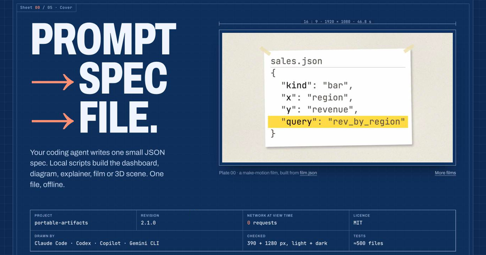
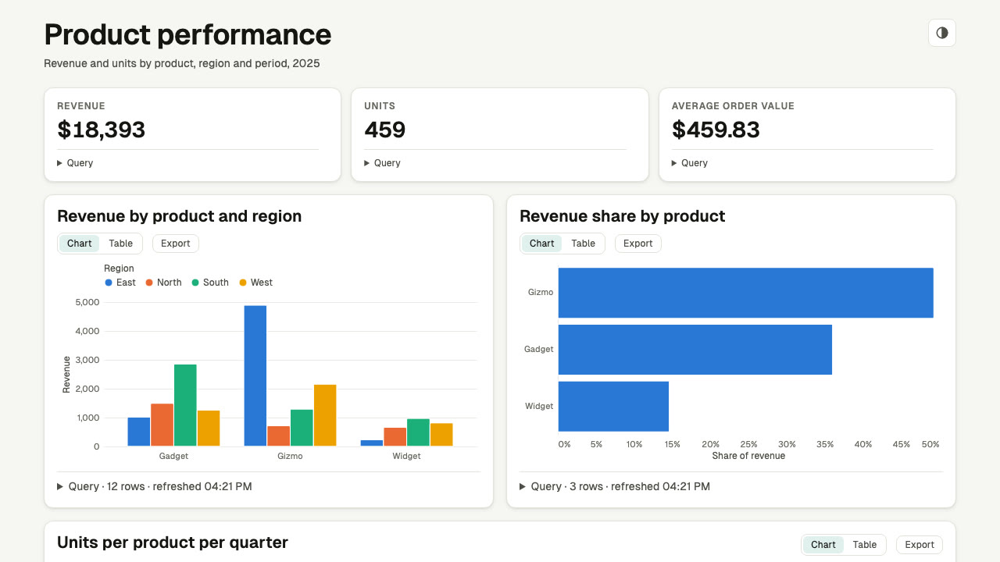
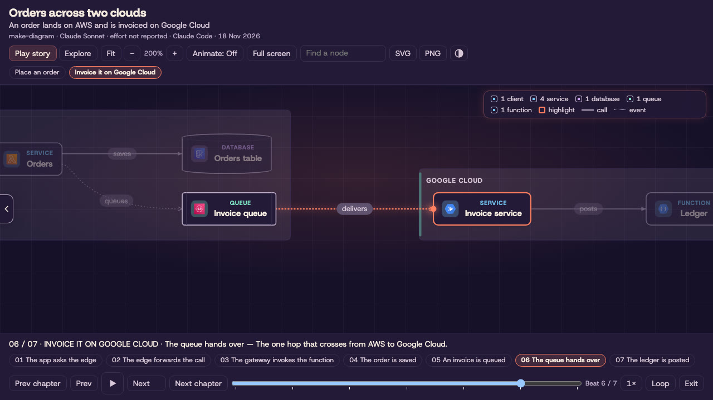
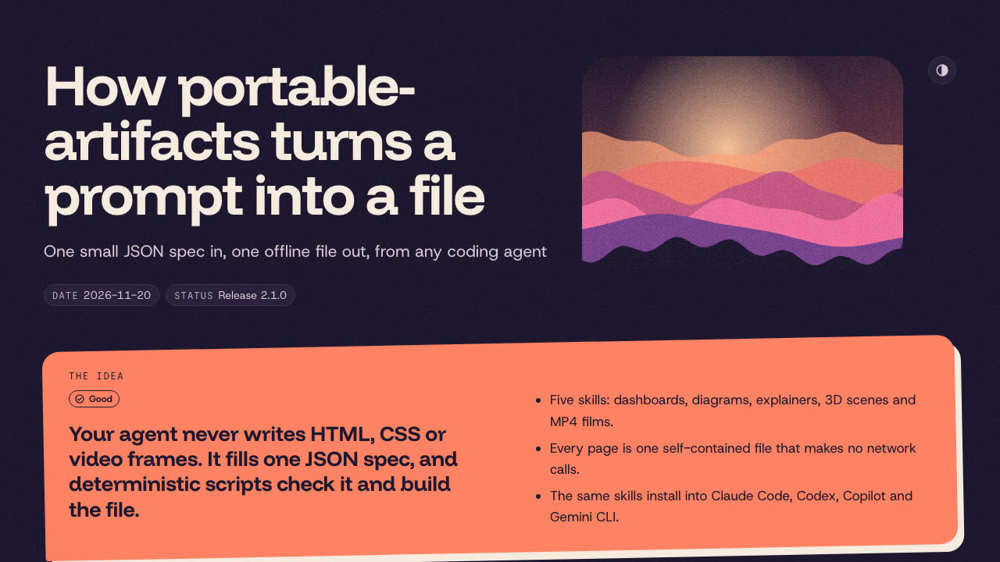
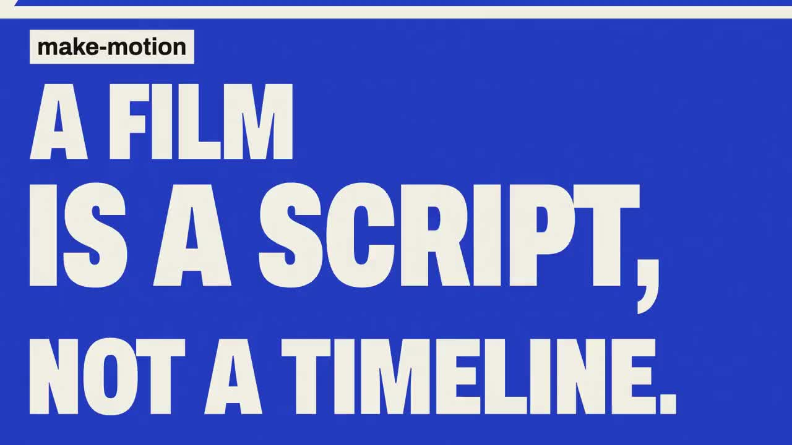
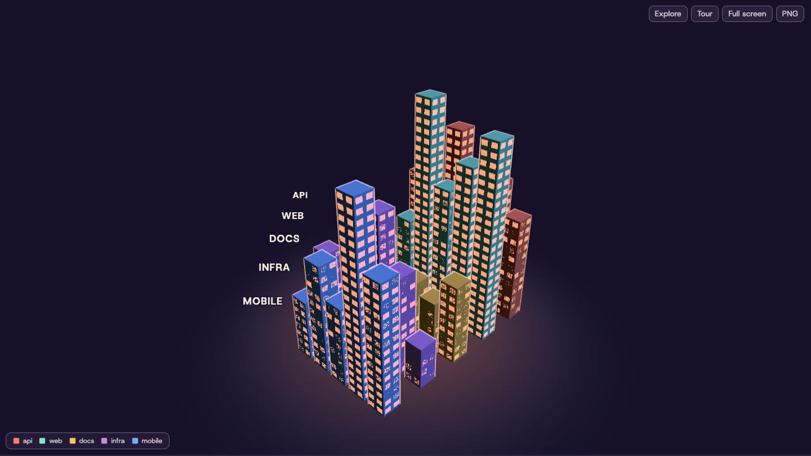

<p align="center">
  <a href="https://abhijitbansal.github.io/portable-artifacts/"></a>
</p>

<h1 align="center">portable-artifacts</h1>

<p align="center">
  <b>Prompt &rarr; spec &rarr; file.</b><br>
  Dashboards, diagrams, explainer pages, 3D scenes and MP4 films from one small JSON spec.<br>
  Built on your machine, offline, by any coding agent.
</p>

<p align="center">
  <a href="https://github.com/abhijitbansal/portable-artifacts/actions/workflows/test.yml"></a>
  <a href="LICENSE"></a>
  <a href="plugins/portable-artifacts/CHANGELOG.md"></a>
</p>

<p align="center">
  <a href="https://abhijitbansal.github.io/portable-artifacts/"><b>Site</b></a> ·
  <a href="https://abhijitbansal.github.io/portable-artifacts/gallery.html">Gallery</a> ·
  <a href="plugins/portable-artifacts/USAGE.md">Usage</a> ·
  <a href="plugins/portable-artifacts/CHANGELOG.md">Changelog</a>
</p>

## Install

Claude Code:

```
/plugin marketplace add abhijitbansal/portable-artifacts
/plugin install portable-artifacts@portable-artifacts
```

Codex, Copilot, Gemini CLI and other agents:

```
npx skills add abhijitbansal/portable-artifacts --skill make-dashboard make-diagram make-explainer make-motion make-scene
```

Then ask your agent for something:

```
/make-dashboard from sales.csv
```

## Five skills

| | |
|---|---|
|  | **`/make-dashboard`**<br>Charts from CSV, Parquet, JSON, DuckDB, SQLite, Postgres or MySQL. Every chart shows its SQL. |
|  | **`/make-diagram`**<br>Architecture, flow, sequence and state diagrams, with stories that play along the edges. |
|  | **`/make-explainer`**<br>Recaps, concept pages, checklists, plans you answer on the page, and slide decks. |
|  | **`/make-motion`**<br>MP4 films from a script of shots, in seven looks, with optional local voiceover and music. |
|  | **`/make-scene`**<br>Your rows as an explorable 3D world: a city, forest, galaxy or terrain, with a camera tour. |

Every image above is a real output. The [gallery](https://abhijitbansal.github.io/portable-artifacts/gallery.html)
shows each one next to the spec that made it.

## Why it is different

- **Offline by construction.** Each page is one self-contained file with a `default-src 'none'` Content-Security-Policy.
  Specs cannot name a remote URL. No account, no cloud.
- **Spec in, file out.** The model writes a short JSON spec. Deterministic scripts validate it, lay it out, render it
  and check it at phone and desktop width. Same spec, same file.
- **Any agent.** One set of skills for Claude Code, Codex, Copilot and Gemini CLI.
- **A cheap model runs the builds.** Measured on 2026-11-18: an Opus director wrote the specs and a Haiku operator ran
  the build command; 10 of 10 films were valid, $4.66 for all ten
  ([run summary](plugins/portable-artifacts/eval/results/summary-director-operator-2026-11-18.md)).
- **Open source.** MIT, built on DuckDB, Vega-Lite, ELK and three.js. Model downloads are pinned to a commit and a
  SHA-256.

## How it works

```
prompt  ->  your agent writes spec.json  ->  validate, lay out, render, check  ->  one .html or .mp4
```

The [plugin README](plugins/portable-artifacts/README.md) covers each skill, themes, the director and operator split and
the security model. [USAGE](plugins/portable-artifacts/USAGE.md) has per-host install steps, prompts to try and
troubleshooting.

<details>
<summary>Installed from the old claude-skills marketplace?</summary>

`portable-artifacts@claude-skills` still works and updates from this repository. Install from one marketplace only,
either `portable-artifacts@portable-artifacts` or `portable-artifacts@claude-skills`: both at once load duplicate
`/make-*` skills. Installed with `npx skills add` or a clone of claude-skills? Reinstall with the commands above.

</details>

## Contributing

Issues and pull requests are welcome; see [CONTRIBUTING.md](CONTRIBUTING.md). Report security issues privately, as
described in [SECURITY.md](SECURITY.md).

## Licence

MIT. See [LICENSE](LICENSE).
